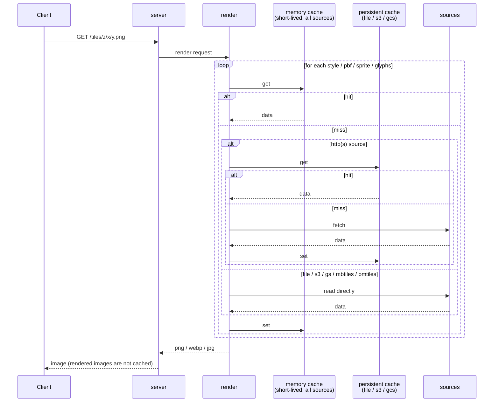

<div align="center">

# chiitiler

**A tiny raster tile server for MapLibre styles.**

Point it at any `style.json` and get back PNG / WebP / JPEG / AVIF tiles, static images, or map cut-outs.

[](https://github.com/Kanahiro/chiitiler/pkgs/container/chiitiler)
[](https://github.com/Kanahiro/chiitiler/actions)
[](https://github.com/Kanahiro/chiitiler/actions)
[](https://codecov.io/gh/Kanahiro/chiitiler)
[](./LICENSE)

[Live Demo](https://spatialty-io.github.io/chiitiler-demo/) · [Quickstart](#from-zero-to-a-rendered-tile-in-30-seconds) · [HTTP API](#http-api) · [Library](#library-usage) · [API Reference](https://kanahiro.github.io/chiitiler/) · [Deployment](#deployment)

</div>

---

## From zero to a rendered tile in 30 seconds

**1. Run the server** — one command, no config file, no database, no API key.

```bash
npm install -g chiitiler   # Node.js 24.22.1+
chiitiler
```

**2. Open a tile in your browser** — pass any MapLibre style URL as `?url=`.

```
http://localhost:3000/tiles/0/0/0.png?url=https://tile.openstreetmap.jp/styles/osm-bright/style.json
```

You're done. That same endpoint works as an XYZ tile source for Leaflet, MapLibre, OpenLayers, QGIS, Cesium, or anywhere else that speaks `{z}/{x}/{y}`.

Start it with `CHIITILER_DEBUG=true chiitiler` and visit `http://localhost:3000/debug` to preview styles interactively.

> **No Node.js?** The Docker image runs the same server: `docker run --rm -p 3000:3000 ghcr.io/kanahiro/chiitiler:latest`

## Features

- **Zero-config** — no config file, no YAML, no database. Just a style URL.
- **No GPU, no system libraries** — rendered by [ml2drender](https://github.com/Kanahiro/ml2drender) (`@ml2drender/node`), a pure-Rust 2D MapLibre renderer, as a Node-API addon
- **Works with any MapLibre style** — remote URL or `POST` the JSON inline
- **Multiple outputs** — slippy tiles (`/tiles`), bounding-box clips (`/clip`), free-form views (`/view`)
- **Pluggable caching** — `file` · `s3` · `gcs` backends for shared source assets, plus an in-process front cache
- **Many protocols** — `http(s)` · `s3` · `gs` · `file` · `mbtiles` · `pmtiles`
- **Library or server** — import the renderer directly into your Node.js pipeline
- **Built-in debug UI** — `/debug` and `/editor` for live style preview

## In Production

- **[MIERUNE/tiles](https://github.com/MIERUNE/tiles)** — [live example](https://mierune.github.io/tiles/color.html#11.62/43.064/141.3375)
- **[PLATEAU VIEW](https://plateauview.mlit.go.jp/)** — Cesium.js imagery via `/tiles`
- **[qgis-amazonlocationservice-plugin](https://github.com/dayjournal/qgis-amazonlocationservice-plugin)** — QGIS integration
- **[Allmaps Latest](https://bsky.app/profile/latest.allmaps.org)** — Bluesky bot
- **[Kumoy](https://www.kumoy.io/)** - used for thumbnail image of designed maps

## Presentations

- [FOSS4G Hiroshima 2026 — Presentation slides](https://drive.google.com/file/d/122JW5gJbrxnUVCVsSlcQMb22StPTnZQV/view?usp=sharing)

## HTTP API

| Method | Endpoint | Description |
| --- | --- | --- |
| `GET` / `POST` | `/tiles/{z}/{x}/{y}[@{n}x].{ext}` | Slippy-map raster tile |
| `GET` / `POST` | `/clip[@{n}x].{ext}` | Bounding-box cut-out |
| `GET` / `POST` | `/view/{zoom}/{lat}/{lon}/{bearing}/{width}x{height}[@{n}x].{ext}` | Free-form view (2D: no pitch) |
| `GET` | `/crs`, `/crs/{id}` | Ids of the registered CRSs, and a CRS's `{ projjson, tileMatrixSet }` (see Custom projections) |
| `GET` | `/debug`, `/editor` | Debug UI (requires `CHIITILER_DEBUG=true`) | — `/debug` switches between the registered CRSs

`ext` is one of `png`, `jpeg`, `jpg`, `webp`, `avif`.

**High-DPI (`@2x`)**: `@{n}x` before the extension (e.g. `/tiles/5/27/12@2x.png`) renders the same
map in `n` times the pixels: labels, lines and icons keep their size on a high-DPI screen, and the
style's sprite is read from `sprite@{n}x`. `tileSize`, `margin`, `size` and `width`/`height` stay in
CSS pixels, so a client keeps its `tileSize` (e.g. 512) and only changes the URL. A larger
`tileSize` instead shows a wider area with smaller labels.

**Query parameters**

| Name | Default | Notes |
| --- | --- | --- |
| `url` | — | Style JSON URL (required for `GET`) |
| `tileSize` | `512` | Tile size in pixels |
| `quality` | `100` | JPEG and AVIF quality (use less than `100` for AVIF: `100` is near-lossless and large). WebP is lossy below `100` (alpha stays lossless) |
| `margin` | `0` | Pixels rendered on each side of the tile and cropped, e.g. to keep labels across tile edges |
| `bbox` | — | `/clip` bounding box: `minLon,minLat,maxLon,maxLat` |
| `size` | `1024` | `/clip` longest edge in pixels |

For `POST`, send the style object as JSON body: `{ "style": { ... } }`.

**Custom projections**: register CRSs with `CHIITILER_CRS_DIR`, a directory of `<id>.json` files, and
render in one with `?crs=<id>` (`GET` and `POST`, every endpoint).

```jsonc
// $CHIITILER_CRS_DIR/utm54n.json → ?crs=utm54n
{
  "projjson": { ... },     // PROJJSON of the CRS, e.g. from `projinfo EPSG:32654 -o PROJJSON`
  "tileMatrixSet": { ... } // its tile grid: required by /tiles and /view, not by /clip
}
```

- `tileMatrixSet` is MapLibre GL JS's grid (`{ "origin": [minX, maxY], "extentAtZoom0": ... }`, as given to `addProjection`) or an [OGC 2D TileMatrixSet](https://docs.ogc.org/is/17-083r4/17-083r4.html) (2.0, JSON).
- `/tiles/{z}/{x}/{y}`: a tile of that grid (`tileSize` is its width; an OGC grid's tiles may be taller or shorter).
- `/clip`: `bbox` in CRS units, `minX,minY,maxX,maxY` (easting first, y up).
- `/view`: `lat`/`lon` in degrees, `zoom` of the grid (its first tile 512 px wide at zoom 0).
- Supported methods and limits: see [ml2drender](https://github.com/Kanahiro/ml2drender#projected-coordinate-reference-systems). An unknown id, an unsupported CRS, an invalid grid or a tile outside it answers `400`.
- The files are read once, at startup; one that is not JSON or has no `projjson` object stops it.
- `POST` also takes a CRS in the body, in the same form: `{ "style": { ... }, "crs": { "projjson": { ... }, "tileMatrixSet": { ... } } }`. It takes precedence over `?crs=`.

The server comes with the CRSs of [`crs/`](crs) (the default `CHIITILER_CRS_DIR`), as `?crs=EPSG-<code>`:

| | |
| --- | --- |
| World | `EPSG-4326` (WGS 84), `EPSG-8857` (Equal Earth) |
| Polar | `EPSG-3413`, `EPSG-3995` (Arctic), `EPSG-3031` (Antarctic) |
| Europe | `EPSG-3035` (LAEA Europe), `EPSG-27700` (British National Grid), `EPSG-2154` (Lambert-93), `EPSG-25832` (ETRS89 / UTM 32N), `EPSG-2056` (Swiss LV95) |
| North America | `EPSG-5070` (Conus Albers), `EPSG-3338` (Alaska Albers), `EPSG-3978` (Canada Atlas Lambert) |
| Oceania | `EPSG-3577` (Australian Albers), `EPSG-2193` (NZTM2000) |
| Asia | `EPSG-5179` (Korea Unified CS), `EPSG-3826` (TWD97 / TM2), `EPSG-6669`–`EPSG-6687` (JGD2011 / Japan Plane Rectangular CS I–XIX) |

Their PROJJSON is PROJ's, and their grid is the square from the top-left corner of the CRS's area of use,
covering it; the world CRSs' (`EPSG-4326`, `EPSG-8857`) is centered on the world instead, as MapLibre GL JS
needs the middle of the grid on the map. To show the tiles with MapLibre GL JS, register the CRS with `addProjection`: its
`tileMatrixSet` from `GET /crs/{id}`, and a converter of its `projjson` (e.g. `proj4('EPSG:4326', projjson)`),
as `/debug` does. Datum
shifts are ignored (as by the renderer). Set `CHIITILER_CRS_DIR` to your own directory to replace them.

**Rendering limits** (ml2drender renders 2D only)

- `fill-extrusion` layers are drawn as flat fills. 3D, terrain, globe, sky and light are not rendered.
- Bidirectional text and Arabic shaping are not supported, and glyphs come only from the style's `glyphs` (no local font fallback).
- JPEG has no alpha: transparent areas become black. Chroma is subsampled 4:2:0 at every quality (as sharp did by default).
- Lossy WebP (libwebp) and AVIF (rav1e at its fastest preset, 4:4:4 chroma), both via `@napi-rs/image`, take about 10 times longer to encode than lossless WebP or JPEG (25–30 ms for a 512px tile): cache the rendered tiles (e.g. behind a CDN) if you use them. AVIF is smaller than lossy WebP from mid quality on, and keeps thin colored lines sharp (WebP subsamples chroma 4:2:0).

## Library Usage

Chiitiler is also a Node.js library. A `Chiitiler` renders any style and returns a `RenderedImage`:
its RGBA pixels, and `toPng()`, `toJpeg(quality)`, `toWebp(quality)` and `toAvif(quality)`.

```bash
npm install chiitiler @maplibre/maplibre-gl-style-spec
npm install @aws-sdk/client-s3     # only for s3:// sources and the S3 cache
npm install @google-cloud/storage  # only for gs:// sources and the GCS cache
```

```ts
import { Chiitiler, ChiitilerCache } from 'chiitiler';

const chiitiler = new Chiitiler({ cache: ChiitilerCache.fileCache({ dir: './.cache', ttl: 3600 }) });
const image = await chiitiler.renderTile({
    stylejson: 'https://tile.openstreetmap.jp/styles/osm-bright/style.json',
    z: 5, x: 27, y: 12, tileSize: 512, margin: 0,
});
const png = await image.toPng();
```

`renderBbox`, `renderView`, their `renderProjected*` variants ([Custom projections](#http-api)), `encode`, your
own `Cache`, custom `Protocols` and `setUserAgent` are documented with examples in the
[API reference](https://kanahiro.github.io/chiitiler/).

## Generating tiles

`generate-tile` renders the tiles of a style into an MBTiles file, without a server:

```bash
chiitiler generate-tile --style style.json --output out.mbtiles --maxzoom 8 --bbox 139,35,141,37
```

With Docker, run `/app/build/main.mjs generate-tile ...` in the image:

```bash
docker run --rm -v "$PWD:/data" -w /data ghcr.io/kanahiro/chiitiler:latest \
  /app/build/main.mjs generate-tile --style style.json --output out.mbtiles --maxzoom 8 --bbox 139,35,141,37
```

| Option | Default | Notes |
| --- | --- | --- |
| `--style` | (required) | Style URL, or a local path |
| `--output`, `-o` | (required) | A `.mbtiles` file |
| `--maxzoom` | (required) | |
| `--minzoom` | `0` | |
| `--bbox` | the world | `minLon,minLat,maxLon,maxLat` |
| `--ext` | `png` | `png`, `jpeg`, `jpg`, `webp` or `avif` |
| `--tile-size` | `512` | |
| `--quality` | `100` | As the server's `quality` |
| `--margin` | `0` | As the server's `margin` |
| `--force` | | Delete an existing `--output` first |

An interrupted or failed run keeps the tiles it wrote: run it again with the same options to resume, skipping them.
An existing file generated with other options (or not by `generate-tile`) is left alone with an error; `--force` replaces it.
Sources are cached as configured for the server (`CHIITILER_CACHE_METHOD`, …). To keep remote sources
between runs (e.g. to resume, or to render more zooms later) in a file cache that does not expire:

```bash
CHIITILER_CACHE_METHOD=file CHIITILER_FILECACHE_DIR=.cache CHIITILER_CACHE_TTL_SEC=0 \
  chiitiler generate-tile --style https://demotiles.maplibre.org/style.json --output out.mbtiles --maxzoom 8
```

Tiles are drawn by `CHIITILER_PROCESSES` renderer processes (unset or `0`: one per 8 threads of `UV_THREADPOOL_SIZE`, which defaults to the CPU count), sharing the thread pool between them; the main process writes the file and fetches their `http(s)://` sources.

## Configuration

The server is configured with environment variables only; it takes no command-line arguments
(not even 1.x's `tile-server` command) but `generate-tile`. Empty values count as unset, and an invalid value stops
startup with an error naming the variable.

```bash
CHIITILER_CACHE_METHOD=file CHIITILER_PROCESSES=0 chiitiler
# Docker: docker run --rm -p 3000:3000 -e CHIITILER_CACHE_METHOD=file -e CHIITILER_PROCESSES=0 ghcr.io/kanahiro/chiitiler:latest
```

### Server

| Variable | Default |
| --- | --- |
| `CHIITILER_PORT` | `3000` |
| `CHIITILER_DEBUG` | `false` |
| `CHIITILER_USER_AGENT` | (none) |
| `CHIITILER_PROCESSES` | `1` (set `0` for all CPUs) |
| `CHIITILER_MAX_SIZE` | `4096` |
| `CHIITILER_MAX_RENDERS` | `0` (no limit) |
| `CHIITILER_CACHE_CONTROL` | (none) |
| `CHIITILER_CORS` | (none) |
| `CHIITILER_CRS_DIR` | the package's [`crs/`](crs) |

`CHIITILER_PROCESSES` runs that many worker processes; `0` uses all available CPUs.
Within a process, rendering and encoding run on libuv's thread pool, as many renders of a style in
parallel as it has threads, so the server keeps answering (e.g. `/health`) while it draws. Its size,
`UV_THREADPOOL_SIZE`, defaults to the number of CPUs, split among the worker processes.

`CHIITILER_MAX_SIZE` bounds every image side in pixels (tiles with their margin, `/clip` sizes, `/view`
dimensions, times `@{n}x`); larger requests answer `400`. `POST` bodies are limited to 16 MiB (`413`).

`CHIITILER_MAX_RENDERS`, when set, bounds the renders in progress in a process, waiting ones included:
beyond it, requests answer `503` with `Retry-After: 1` instead of queueing without bound (by default
they queue: set it where the platform does not already limit concurrent requests). Sources are read for at
most 30 seconds each (http(s), S3 and GCS; a render whose source times out answers `500`), and http(s)
bodies are limited to 64 MiB.

`CHIITILER_CACHE_CONTROL` sets `Cache-Control` on rendered images (e.g. `public, max-age=86400` for a CDN to
keep them; chiitiler doesn't cache rendered images itself). `GET` images carry an `ETag`, so
`If-None-Match` revalidations answer `304`. `CHIITILER_CORS` adds CORS headers for `*` or a comma-separated
list of origins.

On `SIGTERM` / `SIGINT` the server stops accepting connections and exits once the requests in
progress finish (at most 10 seconds).

### Cache

chiitiler caches the **sources** it fetches (styles, tiles, glyphs, sprites), never the rendered
images: put a CDN in front for those (`CHIITILER_CACHE_CONTROL`). There are two layers:

1. **Cache method** — where fetched bytes are kept, chosen with `CHIITILER_CACHE_METHOD`. Each
   method has its own settings (below).
2. **Front cache** — a small in-process memory cache that chiitiler puts in front of every
   method, so that repeated reads skip the disk or the network.

```
renderer needs a URL → front cache      → cache method   → fetch
                       (every source)     (http(s) only)
```

#### 1. Cache method

| `CHIITILER_CACHE_METHOD` | Keeps | Shared between processes |
| --- | --- | --- |
| `none` (default) | nothing | — |
| `file` | files in a directory | yes, on one host |
| `s3` | objects in an S3 bucket | yes |
| `gcs` | objects in a GCS bucket | yes |

`CHIITILER_CACHE_TTL_SEC` (default `3600`) is how long `file` entries live (`0`: never expire). S3 and GCS entries do not expire on their own: use a lifecycle rule.

Settings of each method:

| Method | Variable | Default |
| --- | --- | --- |
| `file` | `CHIITILER_FILECACHE_DIR` | `./.cache` |
| `s3` | `CHIITILER_S3CACHE_BUCKET` | (required) |
| | `CHIITILER_S3_REGION` | `us-east-1` |
| | `CHIITILER_S3_ENDPOINT` | (AWS) |
| | `CHIITILER_S3_FORCE_PATH_STYLE` | `false` |
| `gcs` | `CHIITILER_GCS_CACHE_BUCKET` | (required) |
| | `CHIITILER_GCS_CACHE_PREFIX` | (none) |
| | `CHIITILER_GCS_PROJECT_ID` | (from credentials) |
| | `CHIITILER_GCS_KEY_FILENAME` | (default credentials) |
| | `CHIITILER_GCS_API_ENDPOINT` | (GCS) |

The `CHIITILER_S3_*` settings also apply to `s3://` sources (`CHIITILER_GCS_*` but the bucket and
prefix to `gs://` sources). Credentials come from the standard AWS / GCP environment
(`AWS_ACCESS_KEY_ID`, `GOOGLE_APPLICATION_CREDENTIALS`, …). `@google-cloud/storage` 9
authenticates even with `CHIITILER_GCS_API_ENDPOINT`: an emulator without auth, such as
fake-gcs-server, needs 8.

A cache method keeps `http(s)://` sources only (`pmtiles://http(s)://` tiles included): local
files, `s3://`, `gs://`, `mbtiles://` and local `pmtiles://` are as close as the cache would be.

#### 2. Front cache

Whatever the method, each process also keeps what it reads in memory, for every source:

| Variable | Default |
| --- | --- |
| `CHIITILER_FRONT_CACHE_TTL_SEC` | `10` |
| `CHIITILER_FRONT_CACHE_MAX_BYTES` | `67108864` (64 MiB of payloads per process) |

Set either to `0` to turn the front cache off. Entries live for the TTL from when they were read,
even past their expiry in the cache method. With `none`, the front cache is the only cache.
It also keeps missing resources (404s), so areas without data are not asked for again.

#### Renderers and styles

On top of these, a renderer is kept per style (10 styles, LRU) with the tiles, glyphs and sprites
it decoded, for 5 minutes. Styles given by URL are fetched again after 60 seconds (through the
front cache only), so edits upstream show up within a minute.

## Deployment

- **npm** — `npm install -g chiitiler` installs the `chiitiler` command (Node.js 24.22.1+).
- **Docker** — `ghcr.io/kanahiro/chiitiler:latest` (configured with `CHIITILER_*` environment variables).
  `latest` is the latest release, `next` the latest prerelease, and `v<version>` each one (npm: `chiitiler@latest` / `chiitiler@next`).
- **Docker Compose** — see [`docker-compose.yml`](./docker-compose.yml) (includes RustFS + fake-gcs-server for local testing)

> [!WARNING]
> **Do not expose chiitiler directly to the public internet.** Chiitiler fetches whatever the request tells it to: the `url` style and every source, glyph, and sprite URL inside the style (`GET` or `POST`). This allows SSRF — requests to internal networks or cloud metadata endpoints — and reads of local files (`file://`, `mbtiles://`, `pmtiles://`) and buckets (`s3://`, `gs://`, `pmtiles://s3://`) with the server's credentials. Accept requests only from trusted clients, e.g. behind an authenticating proxy or a private network.

## Migrating from 1.x

2.0 renders with [ml2drender](https://github.com/Kanahiro/ml2drender) instead of MapLibre Native: no GPU, Xvfb or sharp,
faster, smaller and lighter. See [MIGRATION.md](./MIGRATION.md) for benchmarks and breaking changes.

## Develop

Requires Node.js 24.22.1+ and pnpm (`corepack enable`).

```bash
git clone https://github.com/Kanahiro/chiitiler.git
cd chiitiler
pnpm install
pnpm dev              # tsx watch mode
pnpm lint             # biome lint + format check
pnpm test:unit        # vitest
pnpm test:integration # end-to-end
pnpm test:benchmark   # [<baseline checkout>] see tests/benchmark.ts
pnpm build            # bundle to build/main.mjs (loads @ml2drender/node from node_modules)
```

The renderer is [ml2drender](https://github.com/Kanahiro/ml2drender)'s Node-API addon (`@ml2drender/node`);
[`src/render/ml2drender.ts`](./src/render/ml2drender.ts) pools its renderers per style and loads
their resources (`loadResource`) through chiitiler's sources and cache.

## Architecture



## Credits

Inspired by [`maptiler/tileserver-gl`](https://github.com/maptiler/tileserver-gl) and [`developmentseed/titiler`](https://github.com/developmentseed/titiler).

## License

[MIT](./LICENSE) © Kanahiro Iguchi
